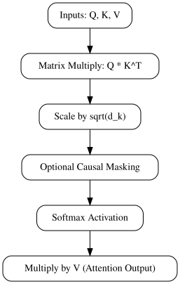
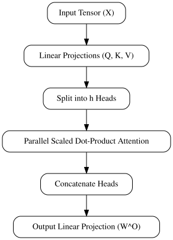

# Demystifying Transformer Architecture and Self-Attention

## Deconstructing Scaled Dot-Product Attention



*Workflow of scaled dot-product attention from query, key, and value inputs to the final output matrix.*

Scaled dot-product attention computes the relationship between queries ($Q$), keys ($K$), and values ($V$). The core formulation calculates similarity scores by multiplying queries with transposed keys, scaling the result, applying a softmax function, and multiplying by values:

$$\text{Attention}(Q, K, V) = \text{softmax}\left(\frac{QK^T}{\sqrt{d_k}}\right)V$$

Here is a PyTorch implementation executing this matrix math from scratch, including optional causal masking:

```python
import torch
import torch.nn.functional as F

def scaled_dot_product_attention(q, k, v, mask=None):
    d_k = q.size(-1)
    scores = torch.matmul(q, k.transpose(-2, -1)) / (d_k ** 0.5)
    
    if mask is not None:
        scores = scores.masked_fill(mask == 0, float('-inf'))
        
    attention_weights = F.softmax(scores, dim=-1)
    return torch.matmul(attention_weights, v), attention_weights
```

### Why the Scaling Factor Matters

Dividing by the square root of the key dimension ($\sqrt{d_k}$) is critical for training stability. As dimensionality $d_k$ grows large, the dot products grow correspondingly in magnitude. Large values push the softmax function into regions with extremely small gradients (vanishing gradients), halting learning. Scaling variance back down to unit variance stabilizes the inputs to the softmax.

### Causal Masking in Autoregressive Decoders

In generative models, tokens must not attend to future context. We enforce causality by applying an upper-triangular matrix filled with zeros (or $-\infty$ before softmax) above the main diagonal:

```python
seq_len = 5
causal_mask = torch.triu(torch.ones(seq_len, seq_len), diagonal=1) == 0
# causal_mask now hides future tokens (value 0)
```

Multiplying scores by this mask ensures future tokens receive zero attention weight.

## Scaling Up with Multi-Head Attention



*Multi-head attention splits query, key, and value matrices across multiple parallel subspaces before combining them.*

Single-head attention forces the model to average out information across a single representation subspace. Multi-head attention solves this limitation by splitting the hidden dimension into $h$ distinct heads, allowing the model to jointly attend to information from different representation subspaces concurrently.

To implement this efficiently in PyTorch, we project the input tensors and reshape them to isolate the head dimension for batched matrix multiplication:

```python
import torch
import torch.nn as nn

class MultiHeadAttention(nn.Module):
    def __init__(self, d_model, num_heads):
        super().__init__()
        self.num_heads = num_heads
        self.head_dim = d_model // num_heads
        
        self.q_proj = nn.Linear(d_model, d_model)
        self.k_proj = nn.Linear(d_model, d_model)
        self.v_proj = nn.Linear(d_model, d_model)
        self.out_proj = nn.Linear(d_model, d_model)

    def forward(self, x):
        batch_size, seq_len, d_model = x.shape
        
        # Project and reshape: (batch, seq_len, num_heads, head_dim) -> (batch, num_heads, seq_len, head_dim)
        q = self.q_proj(x).view(batch_size, seq_len, self.num_heads, self.head_dim).transpose(1, 2)
        k = self.k_proj(x).view(batch_size, seq_len, self.num_heads, self.head_dim).transpose(1, 2)
        v = self.v_proj(x).view(batch_size, seq_len, self.num_heads, self.head_dim).transpose(1, 2)
        
        # Scaled dot-product attention per head
        scores = torch.matmul(q, k.transpose(-2, -1)) / (self.head_dim ** 0.5)
        attn_weights = torch.softmax(scores, dim=-1)
        context = torch.matmul(attn_weights, v)
        
        return context
```

### Complexity and Projection Mechanics

Increasing the number of attention heads ($h$) keeps the total parameter count relatively stable compared to scaling the hidden dimension ($d_{model}$), provided that the per-head dimension ($d_k = d_{model} / h$) remains constant. While computational complexity (FLOPs) scales quadratically with sequence length for both approaches, maintaining a fixed $d_k$ ensures that GPU tensor cores remain efficiently utilized via parallelized matrix multiplication.

Finally, the output linear projection matrix ($W^O$) acts as a mixing layer. It concatenates the individual head outputs back into the original residual stream dimension ($d_{model}$). This linear transformation maps the concatenated subspace representations into a unified feature space before adding them back to the residual stream.

## Common Pitfalls in Transformer Implementation

Building custom transformer blocks from scratch frequently introduces subtle bugs that destabilize training. Here is how to diagnose and resolve the most prevalent failure modes.

* **Unscaled Dot Products and Softmax Saturation:** In high-dimensional spaces where key dimension $d_k$ is large, the dot products grow large in magnitude. This pushes the softmax function into regions with extremely small gradients. When implementing attention, forgetting to divide by $\sqrt{d_k}$ results in vanishing gradients and instantly exploding loss values. Always apply scaling before the softmax activation.
* **Incorrect Positional Encoding Integration:** Positional encodings must be injected correctly to preserve the semantic vector space. A common mistake is concatenating embeddings instead of adding them, which alters the hidden dimension size and breaks subsequent projections. Furthermore, while sinusoidal encodings generalize reasonably well to sequence lengths unseen during training, learned positional embeddings fail catastrophically under extrapolation, often resulting in erratic outputs for sequence lengths exceeding the maximum training length.
* **Diagnostic Checklist for Deep Layers:** During initial training runs, silent numerical failures can cripple convergence before NaN errors explicitly manifest. Monitor these specific metrics:
  * *Attention Entropy:* Track the entropy of your softmax attention weights. Persistently low entropy indicates the model is overly peaking on single tokens, signalling potential attention collapse.
  * *Gradient Norms:* Log gradients layer-by-layer. If gradients vanish exponentially in early layers or explode past a threshold (e.g., global norm > 1.0) in deep layers, adjust your residual connections, layer normalization placement (pre-norm vs. post-norm), or learning rate warmup schedule.