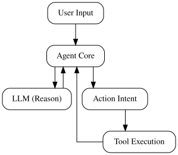

# How AI Agents Work: Architecture, Tool Calling, and Execution Loops

## Architectural Foundation of the Agent Loop

At the heart of any autonomous agent is the ReAct (Reasoning and Acting) execution loop. This paradigm decouples raw model inference from side-effects, relying on a continuous cycle where the agent perceives its environment, reasons about the next step, and executes a tool call.



*The autonomous ReAct loop demonstrating iterative reasoning and tool execution.*

```text
[User Input] --> [Agent Core] <-> [LLM (Reason)]
                      |                 |
                      v                 v
               [Tool Execution] <-- [Action Intent]
```

To implement this loop programmatically, the system must manage iterative generations until a termination condition is met. Below is a minimal Python sketch demonstrating this orchestration:

```python
def run_agent_loop(initial_prompt: str, tools: dict, max_iterations: int = 5) -> str:
    messages = [{"role": "user", "content": initial_prompt}]
    
    for _ in range(max_iterations):
        response = llm.complete(messages=messages, tools=tools)
        
        if not response.has_tool_calls:
            return response.content
            
        messages.append(response.assistant_message)
        for tool_call in response.tool_calls:
            output = tools[tool_call.name](**tool_call.arguments)
            messages.append({"role": "tool", "name": tool_call.name, "content": output})
            
    raise TimeoutError("Agent exceeded maximum iterations without resolving.")
```

Robust state management is critical for preventing context degradation over these iterations. Production systems typically employ an immutable message log append-strategy, coupled with a sliding-window summarizer or vector-store retrieval mechanism to prune stale observational history while preserving semantic state.

## Deterministic Tool Calling and Schema Definition

To bridge probabilistic LLM outputs with deterministic backend systems, agents rely on rigid schema definitions and strict parameter mapping. Modern chat completion endpoints allow developers to bind custom functions directly to the model context using JSON Schema.

Below is an explicit JSON Schema definition for a weather retrieval tool. Enforcing `additionalProperties: false` and listing required fields prevents the model from injecting unhandled parameters.

```json
{
  "name": "get_current_weather",
  "description": "Retrieve the current weather for a specified location.",
  "parameters": {
    "type": "object",
    "properties": {
      "location": {
        "type": "string",
        "description": "The city and state, e.g. San Francisco, CA"
      },
      "units": {
        "type": "string",
        "enum": ["celsius", "fahrenheit"],
        "description": "The temperature unit to use."
      }
    },
    "required": ["location", "units"],
    "additionalProperties": false
  }
}
```

When the LLM responds with a tool call payload, your backend execution loop must safely route the arguments to the underlying function. The following Python handler parses the model payload and dispatches execution:

```python
import json

def execute_tool_call(tool_call):
    name = tool_call.function.name
    args = json.loads(tool_call.function.arguments)
    
    if name == "get_current_weather":
        # Direct mapping to typed backend function
        return get_current_weather(**args)
    raise ValueError(f"Unknown tool: {name}")
```

Allowing LLMs to invoke arbitrary shell commands or database utilities introduces critical security risks. Because LLMs are vulnerable to prompt injection, malicious inputs can manipulate arguments to execute destructive commands (e.g., SQL injection or unintended file system deletions). 

To mitigate these risks, apply strict sandboxing principles: execute code tools inside ephemeral, network-restricted containers (such as gVisor or Firecracker microVMs), and restrict database tools to read-only database roles with strict query parameterization. Never expose raw shell access or unvalidated database connection strings directly to an agent execution loop.

## Common Pitfalls in Agent Execution

Autonomous agents frequently fail in production due to compounding execution errors. When an agent encounters a malformed tool output—such as a truncated JSON payload or an unexpected database error—it often attempts recursive self-correction. Instead of handling the exception gracefully, the LLM interprets its own error message as a prompt to retry the exact same failing action, triggering an infinite execution loop.

To prevent runaway costs and latency spikes, you must enforce strict hardware and software boundaries. Implementing a hard iteration ceiling combined with a token budget tracker halts runaway loops before they drain your API budget:

```python
class AgentBudgetExceeded(Exception):
    pass

class SafeAgentExecutor:
    def __init__(self, max_iterations: int = 5, max_tokens: int = 4000):
        self.max_iterations = max_iterations
        self.max_tokens = max_tokens
        self.current_iteration = 0
        self.tokens_used = 0

    def step(self, prompt: str) -> str:
        if self.current_iteration >= self.max_iterations:
            raise AgentBudgetExceeded("Max iterations reached.")
        
        # Simulate execution and token accounting
        self.current_iteration += 1
        tokens_consumed_this_turn = 450
        self.tokens_used += tokens_consumed_this_turn
        
        if self.tokens_used > self.max_tokens:
            raise AgentBudgetExceeded("Token budget exhausted.")
            
        return "Tool execution result"
```

Even with strict budgeting, diagnosing non-deterministic multi-step failures requires deep system visibility. Standard application logs fall short because agent execution involves dynamic, branching control flows. You need distributed tracing frameworks like OpenTelemetry to capture the parent-child relationships between LLM prompts, reasoning steps, and downstream tool invocations. By propagating trace contexts across tool boundaries, backend engineers can isolate exact failure points, inspect intermediate state payloads, and identify precisely where the agent deviated from its intended execution graph.

## Production Readiness and Evaluation


*Rigorous evaluation and tracing ensure reliability in production AI systems.*

Transitioning an agent prototype into a production service requires moving beyond anecdotal testing to rigorous validation. Start by establishing an evaluation harness using deterministic assertions for multi-turn agent trajectories. You must assert state transitions across reasoning and tool execution steps to catch regressions in prompt handling or logic loops.

```python
def evaluate_agent_trajectory(trajectory, expected_steps):
    for step, expected in zip(trajectory, expected_steps):
        assert step["tool"] == expected["tool"], f"Mismatch: {step['tool']}"
        assert step["args"] == expected["args"], f"Invalid args for {step['tool']}"
```

Next, configure structured JSON logging for every prompt, tool invocation, and raw observation payload. Standardizing logs ensures you can reconstruct the exact context window and system state when debugging complex failure modes.

Finally, bulletproof your architecture with a production checklist:
* **Fallback Models:** Automatically route requests to smaller, deterministic models if primary providers time out or return malformed JSON.
* **Rate-Limiting Handlers:** Implement exponential backoff with jitter on token-bucket constraints to manage upstream API throttling safely.
* **Human-in-the-Loop Gates:** Pause execution loops and trigger approval workflows before executing destructive mutations or high-cost API calls.