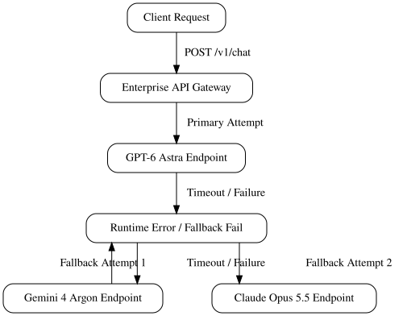

# Navigating the October 2026 AI Landscape: GPT-6 Astra, Gemini 4 Argon, and Autonomous Enterprise Agents

## Architectural Shifts in October 2026 Foundation Models



*A technical flowchart showing how client requests pass through a gateway to various LLM endpoints with automated fallback routing.*

The release of OpenAI's GPT-6 Astra and Anthropic Claude Opus 5.5 introduces critical performance metrics for system architects. When analyzing inference latency and throughput benchmarks, GPT-6 Astra delivers substantial token-per-second gains alongside lower time-to-first-token metrics compared to previous iterations ([Source](https://aistartupedge.com/ai-news-october-2026-updates-trends)). Claude Opus 5.5 maintains competitive edge in complex reasoning tasks, though throughput profiles vary depending on context window saturation ([Source](https://llm-stats.com/llm-updates)).

Simultaneously, Google Gemini 4 Argon brings specialized capabilities for advanced cybersecurity analysis and automated threat hunting ([Source](https://www.linkedin.com/pulse/ai-software-industry-insights-week-october-5th-2026-mark-smith-aptlc)). Its natively multimodal architecture allows parsing of binary artifacts and raw network packet captures directly, transforming how security operations centers handle automated triage ([Source](https://www.evertune.ai/resources/ai-model-tracker)).

To insulate enterprise systems from model-specific degradation or rate limits, architects should implement resilient fallback routing. Below is a minimal configuration snippet using a multi-model gateway pattern:

```python
import os
from openai import OpenAI

client = OpenAI(
    base_url="https://api.gateway.enterprise.internal/v1",
    api_key=os.environ.get("GATEWAY_API_KEY")
)

def query_with_fallback(prompt: str) -> str:
    models = ["gpt-6-astra", "gemini-4-argon", "claude-opus-5-5"]
    for model in models:
        try:
            response = client.chat.completions.create(
                model=model,
                messages=[{"role": "user", "content": prompt}],
                timeout=10.0
            )
            return response.choices[0].message.content
        except Exception as e:
            continue
    raise RuntimeError("All upstream model endpoints failed.")
```

## Integrating Always-On Agents and Digital Coworkers

Deploying autonomous systems like OpenAI Dots and Microsoft Autopilot into production microservices requires robust architectural patterns. Here is a minimal code sketch for orchestrating an autonomous event loop using OpenAI Dots webhook triggers within a Node.js microservice:

```javascript
import express from 'express';
const app = express();
app.use(express.json());

app.post('/api/dots/webhook', async (req, res) => {
  const { eventId, agentId, payload } = req.body;
  // Initialize autonomous execution loop
  console.log(`Triggered Dots agent ${agentId} for event ${eventId}`);
  res.status(202).send({ status: 'processing', eventId });
});
```

When maintaining long-running execution contexts in distributed systems, rely on externalized state stores such as Redis or distributed transaction ledgers. This ensures state recovery across microservice boundaries if an agentic workflow pauses for asynchronous human feedback or long computations.

When delegating system privileges to digital coworkers, enforce strict security and access control boundaries:
*   Implement ephemeral, scoped OAuth2 tokens instead of long-lived static API keys.
*   Enforce human-in-the-loop validation gates for destructive operations like database writes or infrastructure modifications.
*   Isolate agent execution runtime environments inside locked-down sandboxes or micro-VMs.

## Common Pitfalls in Autonomous Agentic Workflows


*An abstract illustration depicting autonomous AI agents navigating complex microservice architectures and monitoring tool loops.*

Transitioning from stateless text generation to stateful, multi-step execution introduces unique reliability hurdles. When deploying newer architectures like GPT-6 Astra or Gemini 4 Argon for complex tasks, engineers often encounter distinct failure modes that require deliberate architectural mitigation.

* **Implement Circuit Breakers for Infinite Loops:** Autonomous agents frequently enter recursive tool-use loops when dealing with ambiguous errors or rate-limiting responses from external APIs. Without hard iteration limits and exponential backoff circuit breakers, an agent will continuously consume tokens and generate cascading timeout errors.
* **Optimize for Cost and Latency at Scale:** Scaling always-on monitoring models across high-throughput enterprise pipelines rapidly inflates inference costs. Caching deterministic intermediate states and routing lightweight classification tasks to smaller models prevents unnecessary calls to expensive flagship architectures.
* **Trace Asynchronous Failures via Distributed Telemetry:** Asynchronous tool execution obscures the causal chain of agent decisions. Use the following debugging checklist to maintain observability across distributed environments:
  1. Inject unique correlation IDs into every agent reasoning step and corresponding tool payload.
  2. Capture raw, unparsed third-party API responses alongside the agent's internal state evaluation.
  3. Set up span alerts for recursive loop patterns exceeding depth thresholds.
  4. Validate asynchronous queue lengths to detect deadlocks during parallel task execution.

## Production Checklist and Next Steps for Engineering Teams

To safely integrate the latest October 2026 AI releases, engineering teams must execute a structured operational roadmap. 

First, build a feature matrix comparing model release tracking tools, such as Evertune ([Source](https://www.evertune.ai/resources/ai-model-tracker)) and LLM-stats ([Source](https://https://llm-stats.com/llm-updates)), to maintain strict compliance auditing and track silent model updates. 

Second, outline a step-by-step canary deployment strategy for upgrading existing production applications to GPT-6 Sol variants:
- Route 1% of non-critical user traffic to the GPT-6 Sol endpoint while monitoring latency anomalies.
- Validate deterministic outputs against cached golden datasets.
- Incrementally scale traffic to 10%, 50%, and 100% over a five-day observation window.

Third, enforce a strict production readiness checklist before full cutover:
- Implement hard cost caps and real-time token budget alerts.
- Configure automated circuit breakers and secondary fallback model providers for zero-downtime failover.

Finally, ensure your team actively monitors ongoing market shifts and infrastructure dependencies by reviewing weekly industry updates ([Source](https://aistartupedge.com/ai-news-october-2026-updates-trends)) and architectural analyses ([Source](https://www.linkedin.com/pulse/ai-software-industry-insights-week-october-5th-2026-mark-smith-aptlc)).