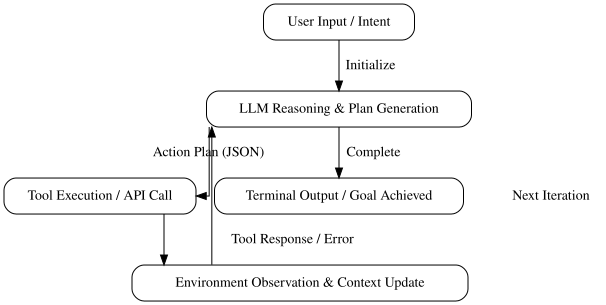

# Under the Hood of Agentic AI: Architecture, Loops, and Execution

## The Agentic Loop: Perception, Reasoning, and Action



*The autonomous agent control loop transitions between user input, LLM reasoning, structured tool execution, and environment observation states.*

The fundamental shift from a static Large Language Model to an autonomous agent relies on the ReAct (Reasoning and Acting) loop pattern. Architecturally, this control loop acts as a deterministic finite state machine (FSM). The system transitions between distinct states—initializing user intent, prompting the LLM for a reasoned plan, executing external tools, and evaluating environment observations—until a terminal termination condition or max iteration limit is reached.

To break free from unstructured conversational text, the agent must output a strictly validated payload that maps directly to execution handlers. Below is a minimal Python sketch demonstrating how an LLM returns a structured JSON action plan:

```python
import json
from typing import Dict, Any

def parse_llm_action(model_output: str) -> Dict[str, Any]:
    try:
        # Enforce structured JSON generation from the underlying LLM
        action_plan = json.loads(model_output)
        if "tool" not in action_plan or "arguments" not in action_plan:
            raise ValueError("Missing required schema keys: 'tool' or 'arguments'")
        return action_plan
    except json.JSONDecodeError as e:
        return {"tool": "error_handler", "arguments": {"message": str(e)}}
```

State management is critical during execution. Every environmental response—whether a tool success code, database rows, or a stack trace—must be systematically appended back into the model's context window. The runner serializes these runtime observations into standard message roles (e.g., `role: "tool"`), preserving historical grounding so the reasoning engine can dynamically adjust its next state transition.

## Tool Integration and Environment Interfaces

Exposing deterministic APIs, databases, and code interpreters to autonomous agents requires rigorous schema definitions and strict isolation boundaries. Without proper serialization and sandboxing, an agent loop can easily destabilize upstream services.

### Function Calling Schemas and Serialization

Agentic frameworks rely on strongly typed schemas—such as JSON Schema or OpenAPI specs—to communicate available tool signatures to the underlying LLM. When an agent decides to invoke a tool, it serializes its intent into a structured payload matching the parameter specification.

```json
{
  "name": "query_database",
  "description": "Executes a read-only SQL query against the analytics replica.",
  "parameters": {
    "type": "object",
    "properties": {
      "sql": { "type": "string", "description": "A valid PostgreSQL SELECT statement." }
    },
    "required": ["sql"]
  }
}
```

The orchestrator intercepts this generated JSON, validates it against the registered schema, and executes the target function in code.

### Security and Sandboxing Considerations

Executing agent-generated code or dynamic database queries introduces severe remote code execution (RCE) and data exfiltration vectors. To mitigate these risks:
* **Database Isolation:** Connect agents exclusively to read-only database replicas equipped with strict query timeouts and resource governors.
* **Code Sandboxing:** Execute dynamic Python or shell scripts inside ephemeral, containerized environments (e.g., gVisor or secure microVMs) with dropped capabilities and zero outbound network access.

### Performance Overhead and Latency

Multi-turn tool calling drastically increases system latency. Each tool roundtrip requires an extra LLM inference pass, network serialization, and execution delay. A task requiring five sequential tool invocations can easily push end-to-end response times past 15 seconds.

### Common Mistakes

* **Trusting Raw Output:** Passing agent-generated parameters directly to an ORM or shell executor without explicit input sanitization or schema validation.
* **Open-Ended Permissions:** Providing agents with production credentials or write-access tokens instead of scoped, ephemeral service accounts.
* **Ignoring Token Bloat:** Injecting massive database schemas or sprawling API documentation into the system prompt, which inflates context windows and degrades reasoning performance.

## Common Pitfalls in Agentic System Design

Deploying autonomous agents to production introduces unique failure modes that traditional software architectures rarely encounter. Without proper constraints, agentic systems can easily degrade performance, exhaust system resources, or incur unexpected API costs.

### Common Failure Modes

*   **Infinite Tool-Calling Loops:** The agent misinterprets a tool's error output, assumes a different argument will fix it, and repeatedly invokes the same function indefinitely.
*   **Cascading Hallucinations:** An early reasoning step introduces a minor inaccuracy. Subsequent steps ingest this falsehood as ground truth, compounding the error until the final output is completely corrupted.
*   **Context Window Exhaustion:** Unchecked conversation histories and verbose tool outputs quickly fill the LLM's context window, leading to degraded attention or hard API payload failures.

### Mitigation Strategies

To prevent runaway loops and protect infrastructure, you must enforce strict operational boundaries:

```python
class AgentExecutionGuard:
    def __init__(self, max_iterations: int = 5, max_cost_usd: float = 0.50):
        self.max_iterations = max_iterations
        self.max_cost_usd = max_cost_usd
        self.current_iteration = 0
        self.current_cost = 0.0

    def check_budget(self, step_cost: float):
        self.current_iteration += 1
        self.current_cost += step_cost
        
        if self.current_iteration > self.max_iterations:
            raise RuntimeError("Circuit breaker tripped: Max iteration limit reached.")
        if self.current_cost > self.max_cost_usd:
            raise RuntimeError("Circuit breaker tripped: Budget cap exceeded.")
```

### Observability and Tracing

Debugging multi-step agent failures requires deep visibility into the reasoning loop. Implement OpenTelemetry spans around every planning phase, tool execution, and evaluation check. Capturing prompt payloads, token counts, and latency metrics per step allows engineering teams to trace where the agent deviated from its goal.

## Evaluation, Testing, and Production Readiness


*Evaluating agentic systems requires a combination of deterministic unit tests, stochastic integration runs, and semantic LLM-as-a-judge validation.*

Deploying agentic systems requires moving away from traditional static assertions toward probabilistic validation. Because LLM-driven loops introduce non-determinism, your validation pipeline must decouple deterministic tool logic from stochastic orchestration flows.

### Production Readiness Checklist
- **Deterministic Unit Testing:** Mock LLM outputs to test individual tool interfaces, schema validation, and error-handling routines in isolation.
- **Stochastic Integration Testing:** Run multi-turn agent execution paths against golden datasets to measure convergence rates and regression across prompt updates.
- **Semantic Evaluation:** Implement LLM-as-a-judge frameworks to grade completion quality, faithfulness, and adherence to system instructions against ground-truth benchmarks.
- **Cost & Latency Tracking:** Instrument your orchestration layer to record token consumption, tool call overhead, and end-to-end execution latency per user request.

### Common Mistakes
- Relying solely on unit tests for tool functions while ignoring end-to-end integration degradation.
- Skipping cost budgets per loop iteration, leading to runaway token consumption during infinite tool-call loops.
- Treating agent observability as an afterthought instead of capturing full execution traces for debugging failed reasoning steps.